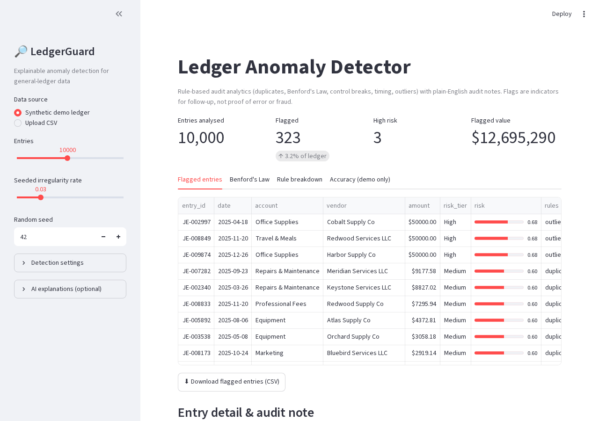

# 🔎 LedgerGuard: Explainable Ledger Anomaly Detector

Upload a general ledger and LedgerGuard flags the entries an auditor would want to look at first: possible duplicate payments, round-dollar postings, weekend and 2 a.m. entries, amounts parked just under the approval limit, segregation-of-duties conflicts, unusually large postings, and vendors whose invoice amounts fail **Benford's Law**. Each flag comes with a plain-English, workpaper-style note explaining *why* it was flagged and what to do next.

> Built for accounting and finance students and practitioners who want to see how data analytics and AI fit into audit work. Flags are **indicators for follow-up, not proof of error or fraud.**

**Live demo:** _add your Streamlit link here_



---

## What it does

| Rule | What it catches | Why an accountant cares |
|---|---|---|
| `duplicate` | Same vendor and amount posted again within 7 days | Duplicate payments are one of the most common and recoverable AP errors |
| `round_number` | Exact multiples of $1,000 (≥ $1,000) | Genuine invoices rarely land on round figures; estimates and fabricated entries often do |
| `off_hours` | Weekend postings and entries outside 7:00-19:00 | Classic journal-entry testing procedure (see AS 2110 / AU-C 240 style fraud-risk testing) |
| `threshold` | Amounts within 5% below the approval limit | Possible split transactions or invoices sized to dodge approval |
| `outlier` | Amounts > 4 robust SDs above the account's norm (log scale, median/MAD) | Misposted decimals, wrong accounts, unusual one-offs |
| `self_approved` | Preparer and approver are the same user | Segregation-of-duties failure |
| `missing_approval` | Entry at or above the limit with no approver | Control deficiency |
| `benford_vendor` | Vendor whose leading-digit distribution fails a chi-square test vs Benford's Law | Fabricated invoices tend to have "invented" digit patterns |

Overall-ledger Benford conformity is also reported using Nigrini's mean-absolute-deviation bands.

**Risk scoring.** Each rule has a weight. An entry's score is `1 − ∏(1 − weight)`, so more independent red flags push risk up with diminishing returns. Tiers: **High** ≥ 0.65, **Medium** ≥ 0.40, otherwise **Low**. Weights and thresholds are in `ledgerguard/detectors.py` and `config.py`.

**Explanations.** By default notes are generated from deterministic templates (free, offline, reproducible). Optionally, paste an Anthropic API key in the app and Claude writes the note instead, constrained to the facts of the flagged entry and instructed never to accuse anyone of fraud. If the API call fails, the app falls back to the template.

## Quick start

```bash
git clone https://github.com/<your-username>/ledger-anomaly-detector.git
cd ledger-anomaly-detector
python -m venv .venv && source .venv/bin/activate     # Windows: .venv\Scripts\activate
pip install -r requirements.txt

streamlit run app.py                                  # interactive dashboard
python -m ledgerguard.cli data/sample_ledger.csv      # command-line version
python -m ledgerguard.generate --n 10000 --seed 42    # regenerate synthetic data
python -m ledgerguard.evaluation --seeds 5            # reproduce the accuracy table below
pip install pytest && pytest -q                       # run tests
```

### Using your own ledger
Any CSV with an `amount` column and a `date` (or `timestamp`) column works. Optional columns improve coverage: `entry_id`, `account`, `vendor`, `description`, `posted_by`, `approved_by`. Rules that need a missing column simply skip. Only use data you are authorised to analyse.

## Results (on synthetic data)

Because the ledgers are synthetic, irregularities are *planted* and the true answers are known. Results averaged over 5 random 10,000-entry ledgers, each with ~298 seeded irregularities (reproduce with `python -m ledgerguard.evaluation`):

| Alert level | Recall | Precision | False-positive rate |
|---|---|---|---|
| Any flag | 98.9% | 92.1% | 0.26% |
| Medium risk or higher | 59.2% | 87.5% | 0.26% |

| Irregularity | Recall |
|---|---|
| Duplicate payments | 100% |
| Round-dollar amounts | 100% |
| Off-hours / weekend | 100% |
| Just-below-threshold | 100% |
| Self-approved | 100% |
| Fabricated vendor (Benford) | 100% |
| Statistical outliers | 86% (subtle ones under 4 SDs are missed by design) |

Full table: [`docs/evaluation_results.md`](docs/evaluation_results.md).

**Read these numbers honestly.** The planted irregularities are cleaner and more obvious than real-world ones, and they were generated by the same author who wrote the rules, so recall on real ledgers will be lower. Single weak signals (just a round number, just a weekend posting) land in the Low tier on purpose, which is why Medium+ recall is lower: they are worth sampling, not escalating.

## How it works

```
CSV ──► normalize_ledger ──► 7 detectors ──► score_entries ──► Streamlit UI / CLI
        (clean types, IDs)    (entry_id,      (weighted risk,     (flagged table, Benford chart,
                               rule, detail)   High/Med/Low)       audit notes, CSV download)
```

```
ledgerguard/
  config.py       thresholds for every rule
  ledger.py       parsing and cleaning (handles "$1,234.50", missing columns, duplicate IDs)
  detectors.py    the rules + Benford's Law helpers
  scoring.py      risk score and tiers, end-to-end analyze()
  explain.py      template notes + optional Claude notes
  generate.py     synthetic ledger with seeded irregularities
  evaluation.py   recall / precision / false-positive measurement
app.py            Streamlit dashboard
tests/            17 unit and end-to-end tests
```

## Limitations

- **Rules, not magic.** The detectors are transparent statistical and control tests. This is deliberate in audit contexts (explainability), but it will not catch sophisticated fraud designed around these tests.
- **Benford's Law doesn't apply everywhere.** Data with caps, fixed prices, or narrow ranges (payroll, rent, utilities with tariffs) can fail naturally. Treat a failure as a prompt to investigate.
- **False positives are expected.** Recurring payments, legitimate round-dollar donations, month-end close work, and planned weekend work will trigger rules. Tune `Config` for the client.
- **Synthetic validation only.** Not yet tested on real or public-case ledgers.
- **Not audit evidence.** This is a learning and screening tool, not a substitute for professional judgment or a complete audit procedure.

## Roadmap
- Journal-entry specifics: debit/credit balance checks, entries to seldom-used accounts, period-end postings
- Isolation Forest / unsupervised model alongside the rules, benchmarked against them
- Sampling export (monetary-unit sampling) from flagged entries
- Support for QuickBooks / Xero export formats

## License
MIT. Built with Python, pandas, NumPy, and Streamlit; optional notes via the Anthropic API.
